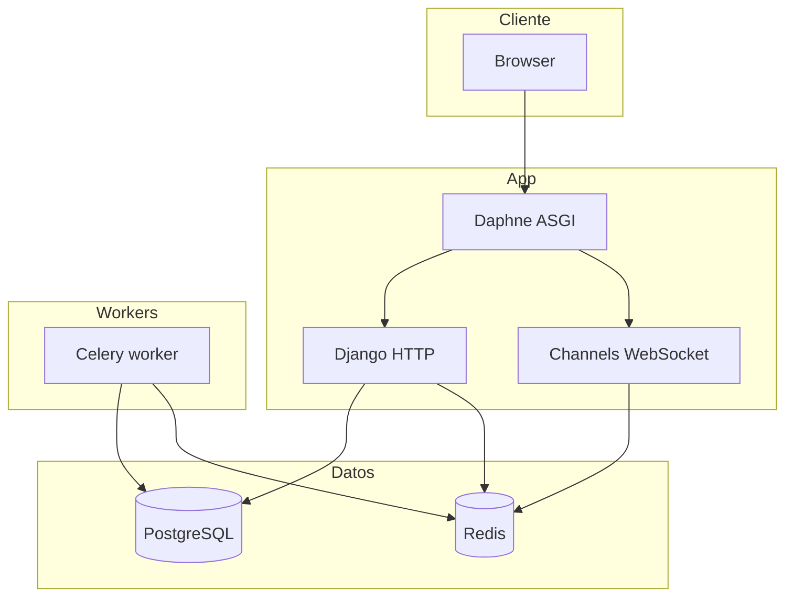

# Arquitectura

## Vista general

- **HTTP** y **WebSocket** comparten la aplicación ASGI en `config.asgi`.
- **Channels** usa `channels_redis` apuntando a `CHANNELS_REDIS_URL`.
- **Celery** usa el mismo Redis con bases lógicas distintas para broker y resultados (`CELERY_BROKER_URL`, `CELERY_RESULT_BACKEND`).

## Módulos Django

| Ruta | Rol |
|------|-----|
| `config/` | Proyecto Django, URLs raíz, ASGI/WSGI, Celery, settings. |
| `apps/core/` | Páginas base y utilidades compartidas. |
| `apps/ai_chat/` | Chat / IA (vistas, parciales HTMX, `routing.py` WebSocket). |
| `apps/docs/` | Documentación de producto (CKEditor, etc.). |
| `apps/legal/` | Legal. |
| `apps/billing/` | Stripe y webhooks. |

## Middleware

Orden relevante: `SecurityMiddleware` → `WhiteNoiseMiddleware` → sesión → `CsrfViewMiddleware` → … → `HtmxMiddleware`.
